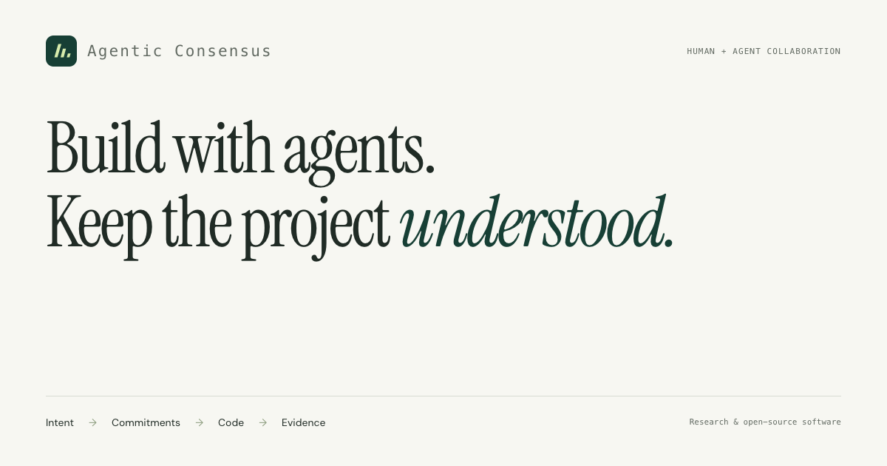

# Agentic Consensus · project website



A research website for **Agentic Consensus**, a shared, versioned project state for human and AI coding collaboration, and **Consensus Control**, its local review workspace.

[**Visit the website**](https://tianfuwang.tech/agentic-consensus/) · [Read the paper](https://arxiv.org/abs/2604.17883) · [Run the implementation](https://github.com/GeminiLight/agentic-consensus)

## The project, in three places

| Repository | Purpose |
| --- | --- |
| [agentic-consensus](https://github.com/GeminiLight/agentic-consensus) | Runnable software, local setup, implementation, and tests |
| agentic-consensus-paper | Private manuscript source and research working files; the public PDF is linked above |
| [agentic-consensus-site](https://github.com/GeminiLight/agentic-consensus-site) | This website, interactive explanation, and public-facing resources |

## What visitors can explore

- A clickable first-screen review trace and a four-step capability-migration walkthrough: intent, changed code, evidence, and an authorized decision.
- The versioned relationship between intent, commitments, artifacts, and evidence.
- Real workspace captures, with separate views for meaning, changes, and decisions, plus an in-page image viewer.
- The arXiv preprint, current research agenda, local setup, and a copyable citation.

The walkthrough is illustrative. The website reflects current research and implementation; the linked arXiv preprint is an earlier version, with an update forthcoming. Human-study results are intentionally omitted. The site does not imply conference acceptance or claim a measured comparative improvement.

## Preview locally

```bash
python3 -m http.server 8924 --bind 127.0.0.1
```

Open `http://127.0.0.1:8924`. The site is plain HTML, CSS, and JavaScript. Fonts and assets are served locally; there is no build step, tracking, or third-party script.

## Verify

```bash
SITE_URL=https://tianfuwang.tech/agentic-consensus python3 scripts/verify-site-seo.py
python3 scripts/verify-content.py
node --check script.js
# With agent-browser installed and the preview server running:
node scripts/verify-browser.cjs http://127.0.0.1:8924
```

The browser check covers responsive widths, both tab groups, hero shortcuts, keyboard navigation, the image viewer, clipboard success and failure, citation links, reduced motion, automated accessibility, and uncaught page errors. See [motion and migration notes](docs/motion-and-migration.md), [content provenance](docs/showcase.md) and [the experience refinement](docs/experience-refinement.md).

## Deployment

The canonical website is **https://tianfuwang.tech/agentic-consensus/**. The implementation already owns that repository name, so its isolated `gh-pages` branch serves **only exported public website files**. Its default code branch and visibility are unchanged. This public repository remains the website source, with PRs targeting `gh-pages`; its Pages configuration serves `legacy-redirect` to forward the old `/agentic-consensus-site/` URL, preserving query strings and section anchors.

After source checks pass and a PR is merged, release from a clean checkout:

```bash
python3 scripts/publish-site.py --output /tmp/consensus-release-primary --publish --target primary
# Verify the new live URL before updating the old redirect:
python3 scripts/publish-site.py --output /tmp/consensus-release-legacy --publish --target legacy
```

Use a fresh output directory per release. Omitting `--publish` prepares files for review without changing GitHub. The script copies an explicit file list plus this repository’s public assets; it does not access code or manuscript working files. Existing deployment branches must carry this website’s release marker. Pages serves `/` from the branches described above. GitHub authentication with push access is required; no token is stored in the repository. Paper actions link to arXiv:2604.17883 and the alphaXiv reader. The legacy PDF asset mirrors the public arXiv version, not a private draft.

Fonts are bundled under the SIL Open Font License; see [the font notices](assets/fonts/). Existing research figures remain available at their previous asset URLs.
